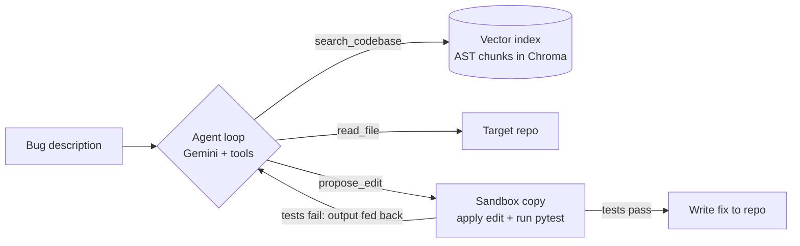

# AI Bug-Fixing Agent

An autonomous coding agent that finds and fixes bugs in Python code, and **proves each fix with your test suite before it touches a single file**.

You describe the bug in plain English. The agent searches the codebase by meaning, reads the relevant files, proposes a fix, and tests it in an isolated sandbox. If the tests fail, it reads the failure and tries again. Only a fix that passes every test is written back.

A run looks like this (illustrative, trimmed):

```
$ python agent.py
=== Round 1 ===
[Action] search_codebase({'query': 'login with unknown username'})
=== Round 2 ===
[Action] read_file({'path': 'app.py'})
=== Round 3 ===
[Action] propose_edit({'file': 'app.py', 'target_name': 'UserManager', ...})
[Verify] Tests PASSED.
[Done] Fix applied to dummy_repo/app.py
```

## How it works



| Part | File | What it does |
| --- | --- | --- |
| Indexer | `indexer.py` | Parses every `.py` file with `ast`, splits it into top-level functions and classes, and embeds them in a Chroma vector store for semantic search. |
| Agent loop | `agent.py` | A Thought, Action, Observation loop using Gemini function calling, with three tools: `search_codebase`, `read_file`, `propose_edit`. |
| Sandbox | `sandbox.py` | Copies the repo to a temp folder, swaps in the new function or class by its AST line range, and runs `pytest` with a timeout. |
| Evaluation | `run_eval.py` | Runs the agent on a benchmark of bug tasks and reports the resolve rate, attempts and time per task. |

## Design decisions

- **Verify before apply.** The model never writes to your files directly. Edits land in a sandbox first, and only a green test run is copied back.
- **Failures are observations.** A failing test run is returned to the model as tool output, so it can correct itself instead of the run crashing.
- **AST-aware edits.** Code is indexed and replaced per function or class, not as raw text, so edits are precise and diff-like.
- **Repo-scoped tools.** Every path the model asks for is resolved inside the target repo. Paths that escape it are refused, and the search index is built per repo.
- **No cheating.** The agent may not edit test files, so it can only pass by fixing the code under test.
- **Resilient API calls.** Exponential backoff on 5xx and per-minute 429 errors. Bad requests and exhausted daily quotas fail fast instead of retrying uselessly.

## Quick start

Requires Python 3.10+ and a free Gemini API key from [Google AI Studio](https://aistudio.google.com/app/apikey).

```bash
pip install -r requirements.txt
export GEMINI_API_KEY="your-key"        # Windows: setx GEMINI_API_KEY "your-key"

python agent.py                          # fix the demo bug in dummy_repo/
python run_eval.py                       # run the full benchmark
python -m pytest test_agent.py test_run_eval.py   # offline tests, no API key needed
```

Set `GEMINI_MODEL` to try a different Gemini model (for example `gemini-flash-latest` if the default is overloaded), and `GEMINI_TIMEOUT_SECONDS` (default 300) to change how long one request may take.

## Benchmark

Six hand-built tasks, each a different classic bug pattern with its own failing test suite:

| Task | Bug pattern |
| --- | --- |
| `task_01_none_check` | Crash on a missing user (`None` not handled) |
| `task_02_off_by_one` | Loop stops one element early |
| `task_03_wrong_operator` | `>` where `>=` is needed |
| `task_04_missing_return` | A branch falls through and returns `None` |
| `task_05_mutable_default` | Mutable default argument leaks state between calls |
| `task_06_falsy_vs_none` | `not value` treats `0` and `""` as missing |

`run_eval.py` restores each task's buggy code after every run, so results are reproducible, and writes a transcript per task to `eval_transcripts/`.

Results: _to be added after the next full benchmark run._

## Tests

16 offline tests mock the Gemini API, so they run in seconds with no key. They cover the loop's stop and retry decisions, failure feedback, the iteration cap, test-file protection, path scoping, retry and backoff rules, and one end-to-end run through a real sandbox and a real `pytest`.

## Limitations and roadmap

- Python only, and edits replace one top-level function or class at a time.
- The sandbox is a temp-folder copy. Running it in a Docker container with no network is the next step for stronger isolation.
- The benchmark is small and hand-built. Moving to SWE-bench Lite needs per-task environments, which is why the official harness uses Docker.

Planned: a web UI that streams each agent step live and shows the verified fix as a diff, support for more model providers with side-by-side benchmark results, a larger benchmark, and CI.

## License

MIT
